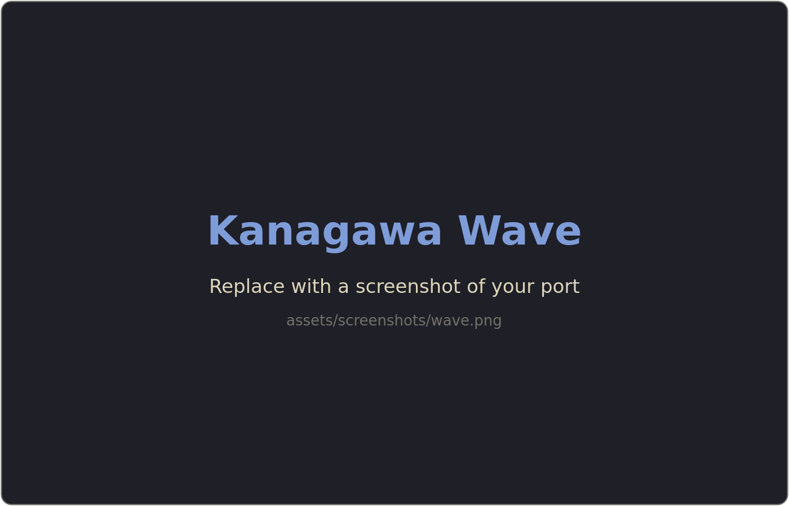
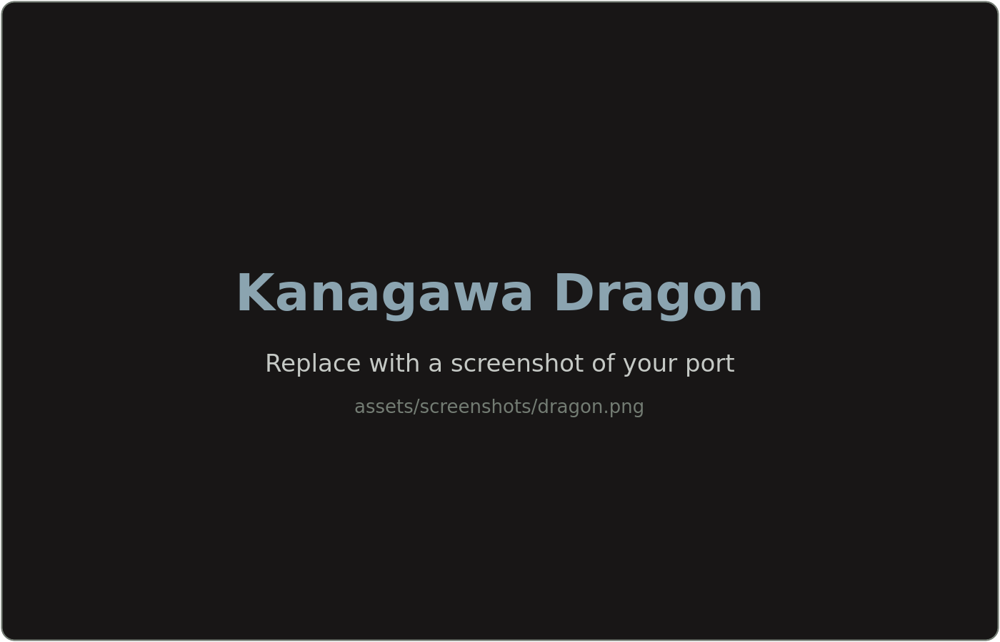
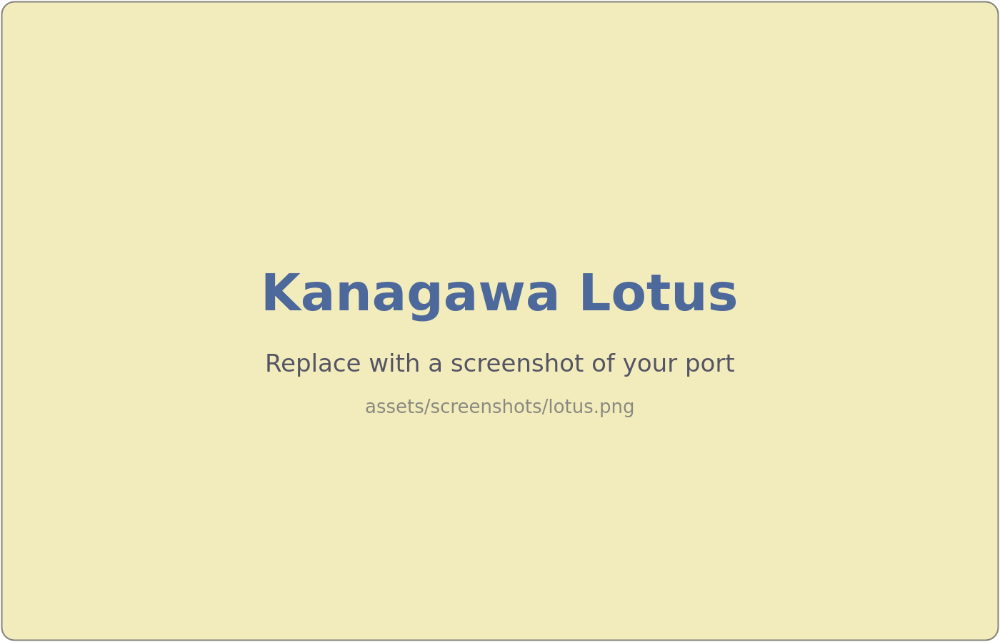

<!-- Replace placeholders. APPLICATION_URL should point to the app's website, or its repository if no site exists. -->
<!--
Setting up a new port from this template:
1. Replace every {{PLACEHOLDER}} in README.md, LICENSE, and cog.toml.
2. Ports based on another project keep that project's license notice in LICENSE
   next to their own, and credit it in the header below.
3. You do not need to tag or protect the repository. Organization maintainers
   add the 0.1.0 baseline tag, the branch rules, and the description and topics
   when the port is adopted.
4. Delete this comment.
-->

<h3>Kanagawa for <a href="{{APPLICATION_URL}}">{{APPLICATION}}</a></h3>

A community-maintained theme inspired by Hokusai's <em>The Great Wave off Kanagawa</em>.

Using the <a href="https://github.com/rebelot/kanagawa.nvim">Kanagawa palette</a> by <a href="https://github.com/rebelot">Tommaso Laurenzi (rebelot)</a>.

<!-- Replace source placeholders; if source is not on GitHub, use its absolute URL. -->
<!-- Optional: credit a specific implementation, palette, or other source when applicable. -->
<!-- Example: Based on [source name](https://absolute-source-url). -->
<!--

Based on <a href="{{SOURCE_URL}}">{{SOURCE_NAME}}</a> by <a href="{{AUTHOR_URL}}">{{AUTHOR_NAME}}</a>.

-->

<!-- Wave accents: carpYellow, crystalBlue, autumnRed. Lotus accents: lotusYellow, lotusBlue4, lotusRed. -->

  <a href="https://github.com/kanagawa-community/{{REPOSITORY}}/stargazers">
    <picture>
      <source media="(prefers-color-scheme: dark)" srcset="https://img.shields.io/github/stars/kanagawa-community/{{REPOSITORY}}?style=for-the-badge&amp;labelColor=1F1F28&amp;color=E6C384">
      <source media="(prefers-color-scheme: light)" srcset="https://img.shields.io/github/stars/kanagawa-community/{{REPOSITORY}}?style=for-the-badge&amp;labelColor=F2ECBC&amp;color=77713F">
      
    </picture>
  </a>
  <a href="https://github.com/kanagawa-community/{{REPOSITORY}}/releases/latest">
    <picture>
      <source media="(prefers-color-scheme: dark)" srcset="https://img.shields.io/github/v/release/kanagawa-community/{{REPOSITORY}}?style=for-the-badge&amp;label=release&amp;labelColor=1F1F28&amp;color=7E9CD8">
      <source media="(prefers-color-scheme: light)" srcset="https://img.shields.io/github/v/release/kanagawa-community/{{REPOSITORY}}?style=for-the-badge&amp;label=release&amp;labelColor=F2ECBC&amp;color=4D699B">
      
    </picture>
  </a>
  <a href="https://github.com/kanagawa-community/{{REPOSITORY}}/issues">
    <picture>
      <source media="(prefers-color-scheme: dark)" srcset="https://img.shields.io/github/issues/kanagawa-community/{{REPOSITORY}}?style=for-the-badge&amp;labelColor=1F1F28&amp;color=C34043">
      <source media="(prefers-color-scheme: light)" srcset="https://img.shields.io/github/issues/kanagawa-community/{{REPOSITORY}}?style=for-the-badge&amp;labelColor=F2ECBC&amp;color=C84053">
      
    </picture>
  </a>

 
 

## Previews

<!-- Keep screenshots in this port repository. Use comparable application content in each. -->

🌊 Wave

🐉 Dragon

🪷 Lotus

## Requirements

- {{APPLICATION}} {{MINIMUM_VERSION}}
- {{OTHER_REQUIREMENT}}

## Installation

{{INSTALLATION_INSTRUCTIONS}}

## Usage

{{QUICK_START_EXAMPLE}}

<!-- Optional sections: keep only those useful for this port. -->

<!--
## Configuration

{{CONFIGURATION_DETAILS}}
-->

<!--
## API

{{PUBLIC_API_DETAILS}}
-->

<!--
## Integrations

{{INTEGRATION_DETAILS}}
-->

<!--
## Palette

{{PALETTE_DETAILS}}
-->

<!--
## Accessibility

{{ACCESSIBILITY_DETAILS}}
Describe tested foreground/background pairs and known limitations. Avoid blanket
WCAG claims unless verified.
-->

## Issues and contributions

Report bugs and request changes in this port's
[issue tracker](ISSUES_URL). Contributions are welcome.

<!-- If this repository has a contributing guide, link it here; otherwise remove this comment. -->
<!-- See [CONTRIBUTING.md](CONTRIBUTING.md). -->

## License

{{LICENSE_TYPE}}. See [LICENSE](LICENSE).

